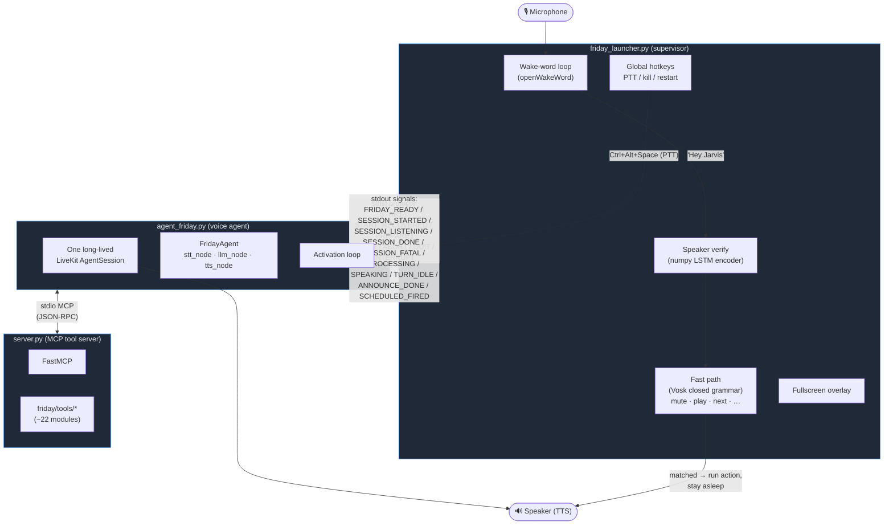
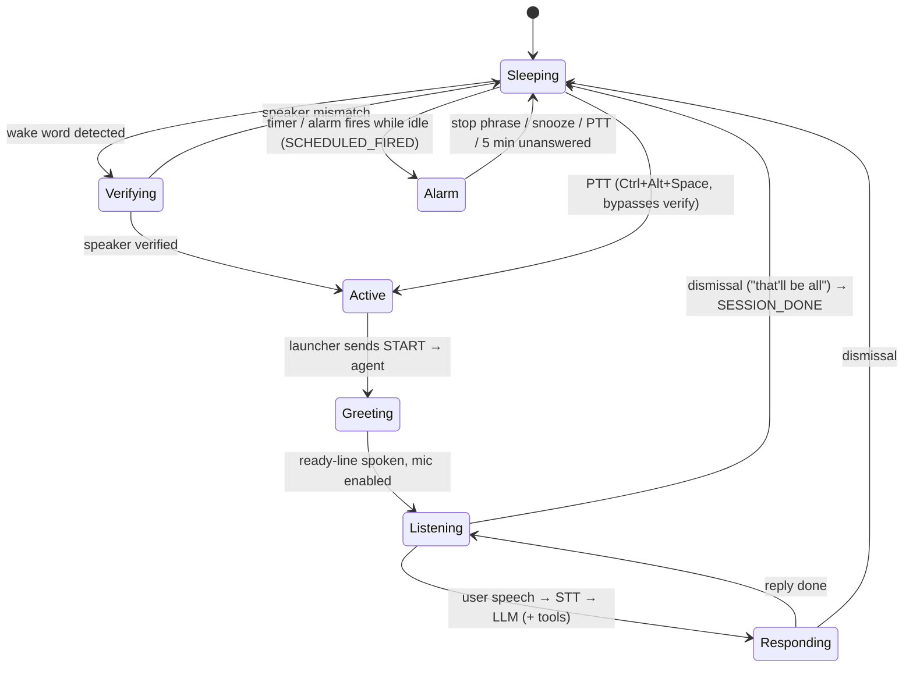
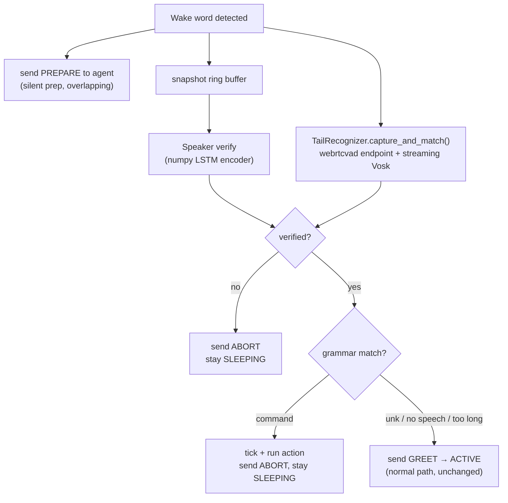
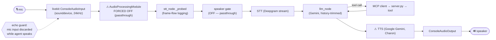
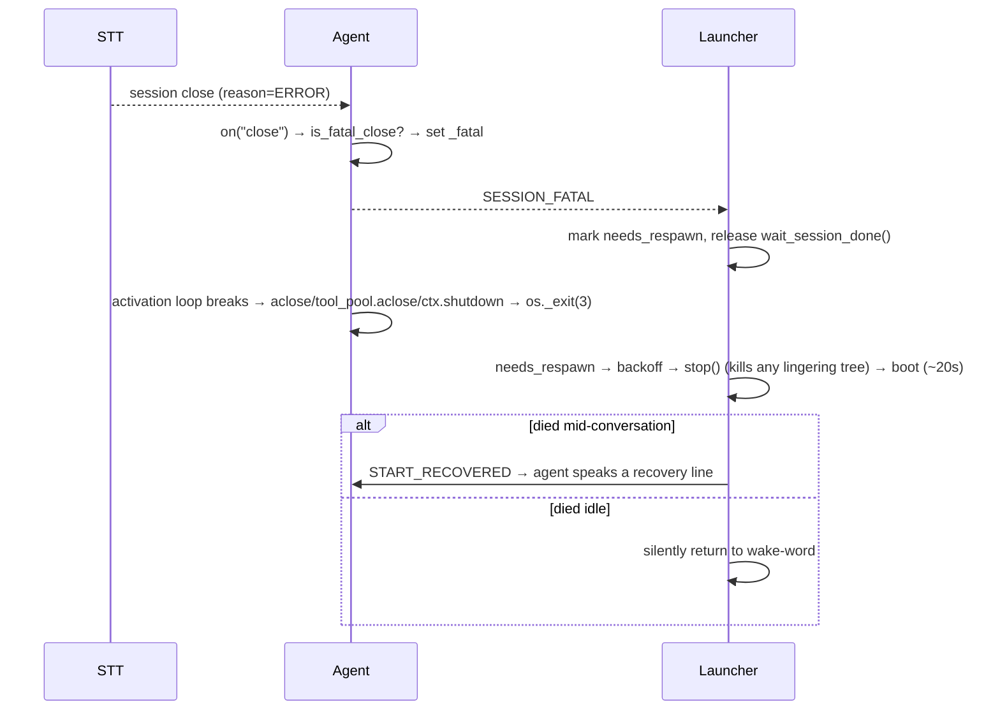
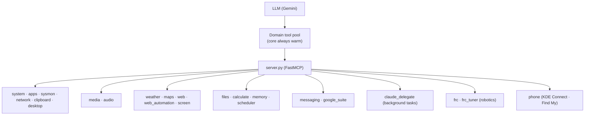
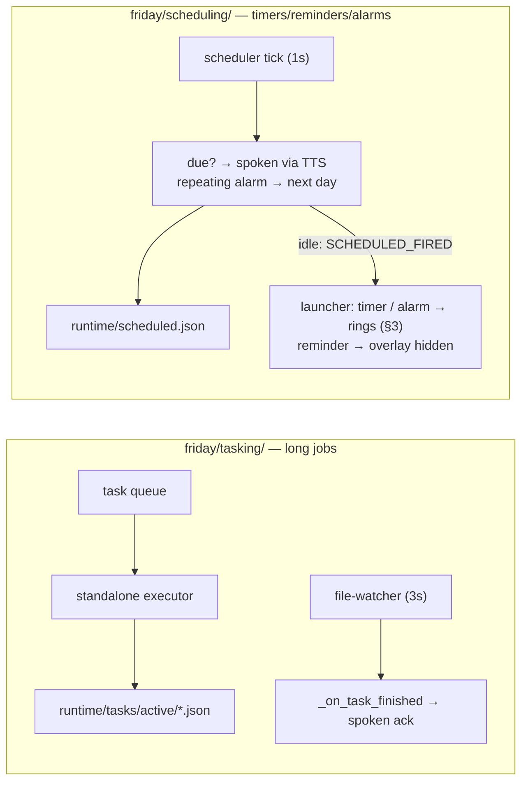

# FRIDAY — Architecture & Feature Diagrams

> **Living document.** Diagrams render on GitHub / VS Code (Mermaid). When you add a
> new feature, tool, process, or data flow, **update the relevant diagram and the
> Feature Map below** in the same change. Keep it matched to reality, not aspiration.
>
> Companion docs: [`CODEBASE.md`](CODEBASE.md) (prose map) · [`CAPABILITY_PLAN.md`](CAPABILITY_PLAN.md) (product direction) · [`TOOL_ROUTING_DESIGN.md`](TOOL_ROUTING_DESIGN.md).

---

## 1. System overview — three cooperating processes

FRIDAY is a voice assistant (Windows and Linux — see §6a) that runs as **three processes**. The launcher
owns the machine-facing bits (mic, hotkeys, overlay) and supervises a long-lived
agent; the agent runs one LiveKit voice session and talks to a local MCP tool server.



**Why 3 processes?** Latency + isolation. The wake-word loop must never block the
conversation; the agent stays warm across dismissals; the tool server can be
restarted independently. The launcher **respawns the agent if it dies** — the basis
of the recovery feature (§5).

Process comms:
- **Launcher → Agent:** writes commands to the agent's **stdin** (`START`, `START_RECOVERED`, `PREPARE`, `GREET`, `ABORT`, `QUIT`, `INTERRUPT`). `PREPARE` starts **silent** prep (STT reconnect, no speech, no mic) the instant the wake word fires, so it overlaps the launcher's fast-path tail capture; it is then completed by `GREET` (speak the ready line, open the mic) or cancelled by `ABORT` (a fast-path command handled the request, or the speaker failed verification — no session begins, no `SESSION_DONE`). `START` is `PREPARE`+`GREET` in one, still used by the PTT and fatal-recovery paths. If no `GREET`/`ABORT` arrives within `PREPARE_WAIT_TIMEOUT` (5s), the agent aborts rather than sitting half-activated.
- **Agent → Launcher:** prints **stdout signals** the launcher parses (`FRIDAY_READY`, `SESSION_STARTED`, `SESSION_LISTENING`, `SESSION_DONE`, `SESSION_FATAL`, `PROCESSING`, `SPEAKING`, `TURN_IDLE`, `ANNOUNCE_DONE`, `SCHEDULED_FIRED {json}`). Overlay: `PROCESSING` → "Thinking...", `SPEAKING` → speaking bars, `TURN_IDLE` (an LLM turn ended with nothing said and no tool to run — e.g. the prompt's silence after a successful action, or a failed LLM call) → back to listening. The last two come only while no session is open, after the agent spoke unprompted: `ANNOUNCE_DONE` (a background task's result) and `SCHEDULED_FIRED` (a timer, reminder or alarm, with its kind, message, due time and label) hand the overlay back to the launcher — which hides it, or for a fresh timer or an alarm rings it (§3). Without them the overlay stayed on "speaking" until the next session.
- **Agent ↔ MCP server:** `MCPServerStdio` spawns `server.py` as a child; tools are called over stdio JSON-RPC.

---

## 2. Boot sequence (`uv run friday_start`)

```mermaid
sequenceDiagram
    participant L as Launcher
    participant A as Agent
    participant S as MCP server
    L->>L: disable power throttling, start overlay
    L->>A: spawn agent_friday.py console FIRST (stdin/stdout pipes)
    Note over L: while the agent boots: load wake-word model (openwakeword),<br/>speaker verifier, Vosk fast path; arm hotkeys
    Note over A: apply Windows net patches (IPv4-only, sequential connect)<br/>+ force console APM OFF  (module import, before livekit)
    A->>A: warm providers (STT/LLM/TTS) + speaker gate (parallel;<br/>gate skips the encoder entirely while disabled)
    A->>A: pre-warm Google TTS grpc channel (list_voices)  ← avoids first-call hang
    A->>A: pre-render wake lines (background; disk cache, ~20ms warm)
    A->>S: spawn server.py, register core toolset
    A->>A: session.start() — acquire console audio, mic gated OFF
    A-->>L: FRIDAY_READY
    L->>L: start wake-word stream → "say 'Hey Jarvis'"
```

Boot is front-loaded on purpose: the LiveKit session, providers, and TTS grpc channel
are all warmed **before** `FRIDAY_READY`, so the first activation pays no cold-start cost.

**Boot budget** (measured 2026-09-21/22): agent spawn → `FRIDAY_READY` ~20s (was
~40s); whole launcher, launch → "say 'Hey Jarvis'" ~21s (was ~42s). The launcher
spawns the agent before loading its own models so the two overlap — keep
`openwakeword` imported lazily inside `WakeWordListener` (at module level it delayed
the spawn ~12s). Guarded by `tests/test_launcher_boot_order.py`. `session.start()` waits for the MCP server, so the server's import time is on
the critical path — keep `friday.tools` free of the voice stack
(`friday/tasking/__init__.py` resolves its API lazily for exactly this reason; it used
to pull LiveKit + Google Cloud into the tool server, ~22s cold). Guarded by
`tests/test_boot_imports.py`. The launcher waits up to `BOOT_TIMEOUT` (120s) and
retries a failed boot `BOOT_ATTEMPTS` times with backoff instead of exiting — cold
boots after a reboot have exceeded the old fixed 60s.

`friday/providers.py` imports **only the plugins this config selects**
(`_register_selected_plugins`, `LOADED_PLUGINS`) — importing all four cost an extra
1.0s of boot (measured 2026-09-22) for providers that are never built. These must be
imported at module level, on the **main thread**: a livekit plugin registers itself on
import and `Plugin.register_plugin` raises *"Plugins must be registered on the main
thread"*, while `build_stt/llm/tts` run in `run_in_executor` worker threads. Moving the
imports into the `build_*` branches therefore breaks boot outright — guarded by
`test_providers_can_be_built_off_the_main_thread`.

---

## 3. Conversation lifecycle



- **Activation** requires the enrolled voice at the **wake word** (launcher's speaker
  verify) *or* a PTT keypress (bypasses verify).
- **The ready line is the wake→listening latency** — the mic is only enabled once it
  finishes playing. It used to be `session.generate_reply(READY_LINE_INSTRUCTIONS)`:
  a Gemini round-trip to improvise one of three phrases the prompt already listed,
  then a TTS synthesis of the result — 3.43–5.30s per wake (median 3.76s, n=5, from
  `logs/friday.log` 2026-09-22). The phrases are now fixed (`READY_RESPONSES`),
  rendered once by `friday/voice_cache.py` into `runtime/voice_cache/*.wav`, and
  replayed with `session.say(text, audio=...)`, which skips both round-trips — the
  wait becomes the line's own playout (1.2–1.6s). Falls back to the live path on a
  cold cache; **recovery** keeps the live path deliberately, since its line has to
  acknowledge the drop that just happened.
  Two constraints on `READY_RESPONSES`, both guarded by `tests/test_ready_line.py`:
  keep each line **short** (it sits on the wake path) and **one sentence** — Gemini
  TTS's streaming plugin segments multi-sentence input and then fails the render with
  *"no audio frames were pushed"*, so such a line would never cache.
  The cache is keyed by `providers.tts_voice_id()`, so retuning the voice
  (`GOOGLE_TTS_*` in `friday/config.py`) re-renders instead of replaying the old one.
- **Silent-mic false wakes** are dropped before verification: openwakeword
  occasionally fires on a near-silent mic, and a wake buffer that never peaks above
  `WAKE_SILENCE_PEAK` is ignored without flashing the overlay or sending `PREPARE`
  (the speaker encoder scores such audio ≤ 0.63, so verification would reject it anyway).
- **Dismissal** is matched case- and punctuation-insensitively, as whole words
  (`_is_dismissal`), so Deepgram's "Goodbye, Jarvis." hits `goodbye jarvis` while
  "understand download" does not hit `stand down`. The sign-off is a pre-rendered
  `SLEEP_RESPONSES` line, played without an LLM turn (`on_user_turn_completed`).
  The session then ends when the sign-off has **finished playing** (`agent_state_changed` speaking → not speaking,
  via `_wait_for_signoff`; capped at `SIGNOFF_START_TIMEOUT` 5s to start and
  `SIGNOFF_MAX_SPEECH` 10s to play) instead of after a fixed 6s, so the wake word is
  back as soon as JARVIS stops talking.
- The **per-transcript** speaker gate inside the session is currently **OFF**
  (`SESSION_SPEAKER_GATE_ENABLED = False`) — see §4 and §6.

### Alarm — a timer or clock alarm firing while idle

```mermaid
sequenceDiagram
    participant S as Scheduler (agent)
    participant A as Agent session
    participant L as Launcher
    S->>S: collect_due: repeating alarm → back on for its next day; missed alarm (>5 min late) → skipped
    S->>A: timer / alarm due, nobody in a session
    A->>A: speak its line (mic stays gated)
    A->>L: SCHEDULED_FIRED {kind, message, fire_at, label}
    Note over L: alarm.should_ring? fresh timer or alarm → State.ALARM
    L->>L: overlay.show() · music ducked to 25% · dim chime loops (runtime/alarm.wav)
    loop until stop/snooze phrase / PTT / ALARM_MAX_SECONDS
        L->>L: wake-word mic → webrtcvad → Vosk (stop-phrase grammar)
    end
    L->>L: chime cut · music restored · overlay.hide() · wakeword.reset() → SLEEPING
    opt heard "snooze"
        L->>S: alarm.snooze → one-time alarm in ALARM_SNOOZE_MINUTES (scheduled.json)
    end
```

- **Clock alarms** (`set_alarm(time, repeat, label)`, `switch_alarm(label_or_id, on)`
  in `friday/tools/scheduler.py`): the Windows Clock alarm by voice — a time of day,
  repeating on chosen weekdays ("weekdays", "mon wed fri", "mon-thu") or once, and an
  on/off switch that keeps it saved (`"all"` switches every alarm, for a break).
  Parsing and next-occurrence math are pure functions in
  `friday/scheduling/recurrence.py`. Stored as `kind="alarm"` items in
  `runtime/scheduled.json` with `repeat` (weekday numbers) and `enabled`; after it
  fires, a repeating alarm's `fire_at` moves to its next day instead of being
  removed. One due more than `ALARM_MISSED_SECONDS` ago (laptop asleep, JARVIS off)
  is skipped without a word, as in Windows — and still rings on its next day.
- **Snooze:** "snooze" (`ALARM_SNOOZE_PHRASES`) in the stop grammar stops the ring
  and writes a one-time alarm `ALARM_SNOOZE_MINUTES` (10) out, labelled
  "snoozed <label>" so cancelling the repeating one by its label can't hit it.

- **Only stop phrases are input.** The agent's mic stays gated; the launcher
  decodes the wake-word stream with the fast path's Vosk model under a grammar of
  `ALARM_STOP_PHRASES` (the dismissal phrases plus "stop", "thank you", "shut up"…)
  and `[unk]`, matched as whole words. Free and offline — no STT or LLM call.
  `hey jarvis` is in the grammar as a **decoy**: "goodbye jarvis" puts "jarvis" in
  it, and without the decoy 1 of 8 recorded wake clips decoded as "goodbye jarvis".
  Checked offline against all 40 recorded wake clips and the chime at 0.5×–4× gain:
  no false stops.
- **Not rung:** reminders (said once), timers more than `ALARM_STALE_SECONDS` overdue
  (came due while JARVIS was off — fired on the first tick after boot), and anything
  in quiet mode, where the agent doesn't speak it either and the launcher shows a
  **sticky** notification instead (critical urgency — stays until dismissed; also
  used when an alarm goes unanswered). Mid-conversation a timer or alarm is just
  said, as before.
- **Chime:** a soft two-note bell built at each launcher boot (`alarm.build_clip`,
  peak `ALARM_VOLUME` of full scale) and looped by `alarm.Ringer`; stopping it kills
  the player mid-clip (`plat.stop_sound`).
- **Music ducks while it rings** (`media_control.duck_playback` / `unduck_playback`):
  every playing stream drops to `ALARM_DUCK_TO` (25%) of its volume and gets its
  exact per-channel volume back when the alarm stops. Spared: JARVIS's own
  processes — its voice is an ALSA stream with no pid of its own, so the pid comes
  from its PipeWire client — and its chime players (`pw-play`/`paplay`/`aplay`):
  PipeWire remembers each app's volume, so a ducked chime that ended before the
  restore would leave every later chime quiet. A stream whose volume was changed by
  hand mid-alarm is left where it was put. Windows does the same through pycaw
  sessions (untested there).
- Push-to-talk during an alarm stops it instead of waking. With no Vosk model, the
  wake word stops it instead of a phrase. Unanswered for `ALARM_MAX_SECONDS` (5 min),
  it stops on its own and leaves a notification.

### Fast path — commands that never reach the agent

Fixed phrases spoken in the same breath as the wake word ("Hey Jarvis, mute") are
recognized and executed **inside the launcher**. No session, no Gemini, no MCP, no
TTS — ~0.4 s versus ~5–7 s through the normal path.



Bail conditions, in order: no speech within `FASTPATH_LEAD_TIMEOUT_MS` (bare
"Hey Jarvis"); speech exceeds `FASTPATH_MAX_SPEECH_MS` (a real request, not a
command); final decode is `[unk]`. All three fall through to normal activation.

- **Command table:** `friday/fastpath/registry.py` — adding a command is one line.
  The Vosk grammar is derived from the table, so a new phrase is recognizable
  automatically.
- **Vocabulary trap:** Vosk silently *drops* words missing from the model's
  vocabulary, making the owning command permanently unmatchable with no runtime
  symptom. `unmute` is one such word (hence "sound on").
  `tests/test_fastpath_vocabulary.py` guards this — it must run the probe in a
  subprocess, because the vosk DLL links its own CRT on Windows and `os.dup2` on
  our fd 2 does not capture its warnings.
- **No early bail on partials.** The 2026-08-01 spike found Vosk emits no partial
  for the first ~880 ms of capture, in-grammar and out alike, so there is nothing
  to reject on before the speech cap fires.
- If the Vosk model is missing or fails to load, the fast path disables itself and
  the launcher behaves exactly as it did before the feature.

---

## 4. Audio pipeline (mic → response)

This is the path a spoken command takes. **Two boxes are the historically painful
ones** (marked ⚠) — see §6 for why.



**Providers** ([`friday/config.py`](friday/config.py) + [`friday/providers.py`](friday/providers.py)): STT=`deepgram`, LLM=`gemini` (`gemini-2.5-flash`), TTS=`google` (Charon).

**Echo guard:** because console AEC is off *and* the speaker gate is off, the mic is
muted while the agent talks (`discard_audio_if_uninterruptible=True`) so FRIDAY never
transcribes its own voice.

**Speak-before-act:** for state-changing tools (open/close app, media, messaging,
reminders, files), the LLM emits a short spoken pre-line ("Opening Chrome, sir.")
*before* the `tool call` edge above, then acts, then stays silent on plain success.
This is prompt-driven (`SYSTEM_PROMPT` "ACTING OUT LOUD" rule in
[`friday/config.py`](friday/config.py)) — LiveKit speaks text that precedes a tool
call in the stream. Pure lookups (math, weather, search) get no pre-line.

---

## 5. Failure recovery (STT session death)

If the STT/connection dies unrecoverably, LiveKit closes the session. The agent turns
that into a **process exit** so the launcher's respawn brings it back.



- **The agent must exit its own process.** Console mode keeps the process alive after
  `ctx.shutdown()`; before the explicit `os._exit`, a fatal close left a zombie agent
  that the launcher (which respawned only on process death) kept sending wake words
  to — ~20 times in the Aug–Sep 2026 logs, each needing a manual restart. The launcher
  now also treats `SESSION_FATAL` itself as "needs respawn", so a lingering process
  is killed rather than trusted.
- **Backoff:** `respawn_backoff` (0, 2, 4, … capped at 30s). An agent that dies within
  `STABLE_UPTIME` (60s) of `FRIDAY_READY` — e.g. network down at boot, Deepgram fails
  a second later — counts as a failed respawn, so an offline machine doesn't reboot
  the agent in a tight loop.

Code: [`friday/recovery.py`](friday/recovery.py) (`is_fatal_close`, `should_announce_recovery`, `respawn_backoff`, `next_respawn_failures`), close handler + `_fatal`/`_intentional` flags in [`agent_friday.py`](agent_friday.py), `AgentProcess.needs_respawn` / `boot()` / `boot_with_retries` in [`friday_launcher.py`](friday_launcher.py). Prevention: widened STT retry/timeout (`STT_MAX_RETRY`, `STT_TIMEOUT`).

---

## 6a. Linux port (KDE Plasma / Wayland / PipeWire)

Same three processes, same protocol. Only the OS plumbing differs, and it is
selected at import time — nothing on the latency path changed.

| Concern | Windows | Linux | Where |
|---|---|---|---|
| Chimes / beeps | `winsound` | `pw-play` / `paplay` / `aplay` | `friday/plat.py` |
| Open file / URL / URI | `os.startfile` | `xdg-open` | `friday/plat.py` |
| Kill agent tree | `taskkill /T /F` | agent is a session leader → `killpg` + psutil descendants | `friday/plat.py`, `AgentProcess` |
| Visible task terminal | `CREATE_NEW_CONSOLE` | `konsole --hold -e` (fallbacks) | `plat.open_terminal` |
| Clipboard | Win32 API | `wl-copy`/`wl-paste`, Klipper D-Bus fallback | `friday/tools/clipboard.py` |
| Screenshot | `ImageGrab` | `spectacle --background` (Wayland blocks direct grabs) | `plat.grab_screen` |
| Click / type / keys / scroll | `pyautogui` | Remote Desktop portal (Wayland lets no other program inject input); one-time KDE approval, kept via a restore token; see §7 Desktop control | `friday/desktop_input.py` |
| Volume / mute | pycaw | `wpctl` (master), `pactl` sink-inputs (per-app) | `friday/media_control.py` |
| Media transport, now-playing | media keys, Spotify window title | MPRIS over D-Bus (`busctl --user`) | `friday/media_control.py` (Spotify Web API first when signed in: `friday/spotify.py`) |
| App launch / close | Start Menu `.lnk`, `taskkill` | `.desktop` entries, SIGTERM by process name | `friday/tools/apps_linux.py` |
| WPILib editor's installed name | `2026 WPILib VS Code` | `FRC VS Code 2026` | `APP_DISCOVERED_ALIASES` (`friday/config.py`), checked first by both `_resolve`s |
| Speaker fingerprint | `voice_embedding.windows.npy` | `voice_embedding.linux.npy` | `plat.voice_embedding_path`, `enroll_voice.py` |
| PTT / restart / kill | global hotkeys (`keyboard`) | signals SIGUSR2 / SIGHUP / SIGTERM (not SIGUSR1 — the PipeWire client blocks it) via `friday_ctl` + `runtime/friday.pid` | `friday_launcher.py`, `friday_ctl.py` |
| Overlay | Tk + Win32 layered windows | Qt subprocess `friday_overlay_qt.py`, fed state names over stdin | `friday_overlay.py` |
| Desktop reacts to JARVIS | — | the same overlay states as a read-only long poll, `GET http://127.0.0.1:47811/state?after=<seq>`, read by the Event Horizon wallpaper (`~/event-horizon`) | `friday/state_feed.py`, `_SubprocessOverlay._send` |
| Wallpaper pulses to music | — | subprocess reads the default output's monitor (`parec`) only while asked, finds bass onsets, long poll `GET http://127.0.0.1:47812/music?after=<beat>` | `friday/music_pulse.py`, `_SubprocessOverlay.start` |
| Wallpaper sky: timers, tasks, notifications | — | subprocess watches `runtime/scheduled.json`, `runtime/tasks/active/`, and Notify calls (`dbus-monitor --profile`, no contents); long poll `GET http://127.0.0.1:47813/sky?after=<seq>` | `friday/sky_feed.py`, `_SubprocessOverlay.start` |
| Focus mode | — | `start_focus` / `end_focus`: closes `FOCUS_CLOSE_APPS`, pauses every MPRIS player, plays `FOCUS_PLAYLIST`, writes `runtime/focus.json` + a `focus` timer; the sky feed holds KDE's notification inhibition while it's on (auto-lifted if the feed dies); the timer's fire speaks a recap | `friday/focus.py`, `friday/tools/focus.py`, `agent_friday._scheduled_fire_instructions` |
| Send to phone (link/file/note) | — | kdeconnectd over D-Bus (`busctl --user`); see §7 Phone | `friday/phone.py`, `friday/tools/phone.py` |
| Autostart / relaunch | Task Scheduler, `start_friday.vbs` | `~/.config/autostart/jarvis.desktop`, `start_friday.sh` | `install_startup.py` |
| Reboot into the other OS | elevated Task Scheduler task `JARVIS Restart into Linux` (UEFI one-shot via `bcdedit`, then restart) | root helper `boot-windows-next` (UEFI one-shot via `efibootmgr`) + KDE logout | `plat.restart_into`, `install_boot_switch.py`, `boot-switch/` |

Linux gotchas:

- **The tool server needs the session environment.** The MCP stdio client gives
  `server.py` only HOME/PATH/USER-style variables by default. Without `DISPLAY`,
  `WAYLAND_DISPLAY`, `XDG_RUNTIME_DIR` and `DBUS_SESSION_BUS_ADDRESS`, launched
  apps crash on start (VS Code core-dumped) and MPRIS, clipboard and screenshot
  calls fail. `plat.tool_server_env()` passes the full environment.
- **No global hotkeys on Wayland.** Ordinary apps can't hook keys system-wide and
  the `keyboard` package needs root. Bind `friday_ctl ptt|restart|kill` to
  shortcuts in System Settings instead.
- **Overlay runs through XWayland** (`QT_QPA_PLATFORM=xcb`). A native Wayland
  client can't place itself, stay on top, or bypass the window manager; an X11
  override-redirect window with an empty input region can.
- **PySide6 is pinned `<6.12`.** 6.12.0 drops a reference to `None` on every
  void call; on Python 3.11 (no immortal `None`) the overlay aborted after a few
  seconds of painting.
- **`read_long_content` can't scroll on Wayland** unless `ydotool` is installed —
  input injection needs uinput. `read_screen` is unaffected.
- **The FRC Driver Station is Windows-only**; other dashboards launch from the
  WPILib `.desktop` entries.
- **One speaker fingerprint per OS.** Both installs share this repo through git,
  and a single `voice_embedding.npy` meant enrolling on one OS replaced the
  other's fingerprint on the next pull. The launcher's wake gate, the in-session
  gate and `enroll_voice.py` all take the path from `plat.voice_embedding_path()`,
  so run `enroll_voice.py` once on each OS. On Windows it finds the running
  launcher by command line (no PID file there) to stop and restart it.
- **Fingerprint clips are cleaned first** (`friday/voiceprint.py`). The 2.5s
  behind a wake word is ~1s of "Hey Jarvis" and the rest is the room and the mic.
  Three steps, the same in the wake gate, the in-session gate and enrollment (so
  re-enroll after changing any): **high-pass at 300 Hz**, cut the silence
  (webrtcvad), level the volume. The high-pass is the important one: this mic
  carries a rumble below 70 Hz as loud as quiet speech, plus a 120 Hz hum while
  charging, and both ended up in the fingerprint — two enrollments of the same
  person a day apart matched at only 0.68 and the owner passed ~1 wake in 10.
  Wake threshold is 0.65. `enroll_voice.py` keeps its raw samples in
  `runtime/voice_enroll/`, and the launcher keeps the last 40 wake clips with
  their scores in `runtime/wake_clips/` (both untracked) for diagnosis.
- **Deepgram ends the user's turn, not the local VAD** (`_stt_ends_turns` in
  `agent_friday.py`; `turn_detection="stt"`, Deepgram `endpointing_ms=300`, no
  VAD on the agent). The WebRTC VAD hears steady mic noise as speech: a 120 Hz
  mains hum on the charging laptop kept it "speaking" indefinitely, so a
  finished transcript never became a turn and JARVIS sat silent (typed
  requests still worked). Other STT providers keep the VAD.
- **Mains hum is filtered out of the session mic** (`friday/mic_filter.py`, a
  250 Hz high-pass applied to every frame in `stt_node`). Deepgram's endpointing
  was fooled by the same 120 Hz tone: measured against the live API, it never
  sent `speech_final` with the hum, and did once the hum was filtered. The
  wake-word path is not filtered (the enrolled fingerprint was made unfiltered).
  Deepgram also gets `keyterm=["FRC", "FRC mode"]` — it kept hearing "Foci mode".

## 6b. Quiet mode and typed requests

**Quiet mode** (`friday/quiet.py`, state in `runtime/quiet.json`) means JARVIS
makes no sound: the launcher drops wake-word hits and push-to-talk, a fatal
close recovers without the spoken recovery line, and a timer, reminder or alarm that
fires while idle is a desktop notification instead of a spoken line and ring (one
that stays until dismissed, for a timer or alarm). It is on automatically while
the laptop is on a Wi-Fi network marked as school (`friday_ctl school add`). A
manual `friday_ctl quiet on|off` overrides that, but only while the laptop stays
on the network it was set on, so a "you may talk" granted once can't leak into
another day's class. `friday_ctl quiet auto` clears the override.

**Typed requests** reach the same session as voice, silently:

```
KRunner "j …"  ─┐
friday_ctl ask ─┴─> runtime/friday.sock ─> launcher ─ stdin "TEXT {json}" ─> agent
                                                                              │ session.generate_reply(user_input=…)
reply (print / notification) <─ launcher <─ stdout "TEXT_REPLY {json}" <──────┘ with audio output disabled
```

- The agent handles `TEXT` inline in `_stdin_dispatch_loop` (like `INTERRUPT`),
  so it works asleep or mid-conversation and never touches the activation queue.
  Same history, tools and prompt as voice; with no voice session live, audio
  output is switched off for the turn, so no TTS is synthesised at all.
- A request with `"announce": true` (`AgentProcess.ask(…, announce=True)`) is a
  line to say, not a thing to do: audio stays on and the turn runs with
  `tool_choice="none"`. Used by the cross-OS handoff's confirmation (below).
- The launcher matches `TEXT_REPLY` before its other stdout signals: reply text
  is arbitrary and could contain "SPEAKING" or "PROCESSING".
- `friday_krunner.py` is a D-Bus service (`org.kde.krunner1`, bus-activated). It
  claims only queries starting `j ` / `jarvis `, returns a single "Ask JARVIS"
  match without calling the model (Match fires per keystroke), and on Run
  forwards the text and shows the reply as a notification.

**Tray button** (`friday_tray.py`, Linux): a Qt `QSystemTrayIcon` in its own
process, spawned by the launcher and tied to it through a stdin pipe (EOF →
exit). It keeps no state: every 2s it reads `status` from the control socket
and draws one of four icons — active, sleeping, quiet, offline. Left click
types a request, middle click is push-to-talk, the menu toggles quiet mode and
restarts or quits JARVIS. `FRIDAY_NO_TRAY=1` disables it.

**Cross-OS handoff** (`friday/handoff.py`): the laptop dual-boots and JARVIS
runs on both sides, but neither OS can read the other's disk (BitLocker one way,
ext4 the other). A task for the other OS is therefore queued as an event on a
private Google Calendar, "JARVIS Handoff", using the Calendar sign-in both sides
already have; `FRIDAY_HANDOFF_DIR` swaps in a folder queue.

```
Linux:   "FRC mode" ─> start_frc_mode ─> handoff.leave_task("FRC mode", windows)
                                      └> plat.restart_into_windows()  (firmware one-shot + KDE logout)
Windows: launcher boots ─> agent ready ─> handoff.claim_pending() ─> agent.ask(task) ─> queue.finish(done)
                                          ─> agent.ask(handoff.pickup_confirmation(…), announce=True)
                                             "Welcome back to Windows, sir. Opened up FRC mode for you."

Windows: "switch to Linux [and …]" ─> leave_task_for_other_os ─> handoff.leave_task(…, linux)   (only if there is a task)
                                                              └> plat.restart_into_linux() ─> schtasks /run "JARVIS Restart into Linux"
         "Restart into Linux" shortcut (Desktop / Start menu) ────────────────────────────────┘
         the task, elevated: bcdedit /enum firmware ─> find the Linux loader's entry
                             ─> bcdedit /set {fwbootmgr} bootsequence <id> ─> shutdown /r /t 0
```

- The note is saved BEFORE the reboot is scheduled, and the reboot is checked
  to be possible BEFORE the note is saved: never a reboot with nothing waiting,
  never a stray task ambushing a later boot.
- Tasks expire after 12 hours (`handoff.MAX_AGE`) and are retired unrun.
- Pickup runs after `FRIDAY_READY` as a background task, through the silent
  typed-request path, so it never delays the wake word and respects quiet mode.
- **Then it is confirmed out loud**, in a turn of its own: "Welcome back to
  Windows, sir. Opened up FRC mode for you." (`handoff.pickup_confirmation`,
  sent as an `announce` request — spoken, no tools). The welcome is only on the
  first task of a boot; a part that failed is named instead of claimed. In quiet
  mode the outcome is a notification instead. A bare switch leaves no task, so
  there is nothing to confirm and nothing is said.
  - Two turns, not one: asked to act and confirm together, the model said the
    confirmation before acting and again after, or said it and never acted
    (dry runs against the real model, 2026-10-11).
- `leave_task_for_other_os` (friday/tools/handoff.py) is the general tool:
  "next time I'm on Windows, …". With `restart_now` it also switches, in either
  direction; a bare "switch to Linux" restarts without queuing an empty note.
- **Windows → Linux** (`install_boot_switch.py install`, once): Windows can't
  steer GRUB, so it asks the firmware to boot the Linux entry next, once. That
  needs admin, hence a Task Scheduler task that runs elevated — the one UAC
  prompt is at install time; the shortcut and JARVIS just run the task.
  - The task's whole action is an inline PowerShell command with absolute
    System32 paths: nothing a non-elevated process can edit runs elevated.
  - The entry is found by its loader path (`\EFI\<distro>\shimx64.efi`) on every
    click, not stored by id: Windows re-ids the entry when it is re-created.
  - The restart happens only if the one-shot was set, and is not forced
    (`/t 0`), so unsaved work still gets its prompt. Failure shows a dialog.
  - Allowed on battery explicitly — Task Scheduler's default is to silently not
    start a task there.
  - This only guarantees GRUB loads next; which entry GRUB then picks is GRUB's
    own default (Linux side: `GRUB_DEFAULT` / `GRUB_TIMEOUT`).
  - Guarded by `tests/test_boot_switch.py`, which runs the task's real script
    against stand-ins for `bcdedit` and `shutdown`.
- **Linux → Windows goes through the firmware too, never through GRUB**
  (`boot-switch/boot-windows-next`: `efibootmgr --bootnext <Windows Boot
  Manager>`; `install_boot_switch.py install` on Linux puts it in
  `/usr/local/sbin`). Windows is BitLocker-encrypted with the key sealed to the
  TPM. A Windows that GRUB chain-loads has shim/GRUB in its measured boot chain
  (PCR 7), the TPM refuses the key, and Windows asks for the 48-digit recovery
  key — every time. Windows' own log says so: BitLocker-Driver 24635 "PCRs did
  not match", BitLocker Management 881 "OS Loader Authority … not in the
  verified certificate chain for the boot manager". Started by the firmware it
  unlocks by itself. Same reason not to pick "Windows" in the GRUB menu by hand.
- **GRUB's menu must time out into Linux** for the Windows → Linux switch to be
  hands-free: the one-shot only gets as far as GRUB. That is `GRUB_TIMEOUT` (and
  on Ubuntu `GRUB_RECORDFAIL_TIMEOUT`) in `/etc/default/grub`, then regenerate
  `grub.cfg`.
- **Both OSes must agree on the hardware clock.** Linux keeps it in UTC, Windows
  reads it as local time, so after a boot from Linux Windows runs hours ahead
  (4 h in EDT; measured 2026-10-11, with the Windows Time service stopped).
  Google then rejects the TTS service account — 401 `ACCESS_TOKEN_EXPIRED`,
  "failed to synthesize speech" — and JARVIS is mute on Windows except for the
  pre-rendered wake lines; commit times from the two sides also interleave
  wrongly. Fix on Windows, once, elevated: `RealTimeIsUniversal=1` (DWORD) under
  `HKLM\SYSTEM\CurrentControlSet\Control\TimeZoneInformation` (set 2026-10-11;
  it applies from the next restart — System log, Kernel-General event 25, then
  reads "RTC time is in UTC: true"). A JARVIS started under a wrong clock keeps
  its rejected sign-in for hours: after any clock correction, restart it.
- **A voice switch to Linux logs in without the password, once.** The user was
  just recognised by voice on Windows, so typing a password on arrival is the
  only step left that needs hands.

  ```
  Windows: "switch to Linux" ─> plat.restart_into_linux ─> task "JARVIS Voice Switch to Linux"
           (the plain task's steps) + write <EFI partition>\EFI\jarvis\autologin-once ─> restart
  Linux:   jarvis-autologin-once.service (root, before the login screen)
           pass there?  yes ─> delete it, write /etc/sddm.conf.d/90-jarvis-autologin.conf ─> SDDM logs in
                        no  ─> delete that config ─> password screen
  ```

  - Two tasks on Windows: the "Restart into Linux" shortcut runs the plain one
    and leaves no pass, so a switch by hand still ends at the password. JARVIS
    runs the voice one when it is registered, else the plain one.
  - The pass is on the EFI system partition because it is the only partition
    both systems can read. It is written after the one-time boot is set (no
    pass from a switch that failed) and never blocks the restart.
  - Linux removes the autologin config on every boot before deciding, so one
    pass is one login. A pass it cannot delete is ignored. Waking from sleep
    is the lock screen, not SDDM — it still asks.
  - It is a convenience, not a proof: anything that can write the EFI
    partition (a Windows admin, a USB boot) can leave a pass. The Linux
    partition is not encrypted, so that same access already reads every file.
  - `install_boot_switch.py install` on each OS sets it up; `uninstall` on
    Linux removes it. Guarded by `tests/test_boot_switch.py`.

**FRC mode** (`start_frc_mode` in `friday/tools/frc.py`): on Windows it opens
FRC VS Code, the Driver Station (which brings Elastic up) and AdvantageScope. On
Linux, where the Driver Station doesn't exist, it hands off to Windows as above.
The tool's description is built per OS: only off Windows does it tell the model
that it restarts the computer and to say "Switching, sir. …" — read on Windows,
the model announced a switch while already there.
Spoken names for these apps live in `APP_DISCOVERED_ALIASES`.

## 6. Windows / platform gotchas (applied fixes)

These are non-obvious workarounds baked into `agent_friday.py`. **Do not remove without
understanding why** — each cost a long debugging trail.

| Fix | Where | Problem it solves |
|-----|-------|-------------------|
| **IPv4-only DNS + sequential connect** | `_force_ipv4_resolution`, `_patch_anyio_happy_eyeballs` (top of agent_friday.py) | Windows `ProactorEventLoop` wedges forever when a losing IPv4/IPv6 "happy-eyeballs" TCP connect is cancelled → the greeting/LLM connection hung. Escape hatch: `FRIDAY_DISABLE_NET_PATCHES=1`. |
| **Google TTS grpc channel warmup** | pre-warm block after providers | grpc establishes the HTTP/2 connection lazily on first synthesis, under session load, and hangs. Warming `list_voices()` at boot connects it early. |
| **Console APM forced OFF** | `_force_console_apm_off` | livekit's console `AudioProcessingModule` (AEC+NS+AGC) stripped the user's voice to the noise floor → STT got silence → no transcripts. Escape hatch: `FRIDAY_KEEP_APM=1`. |
| **Echo guard** | `discard_audio_if_uninterruptible=True` | With APM + speaker gate off, prevents transcribing the agent's own TTS. |
| **Turns start and end on words, not sound** | `friday/turn_end.py` — wrapped around the STT events in `FridayAgent.stt_node`; `STT_WORD_SILENCE_END` (config) | Deepgram's endpoint (`speech_final`) needs 300ms of silence and its `SpeechStarted` comes from an audio VAD. A fan is steady noise: the silence never came, so a finished request sat unanswered until the mic was muted, and a noise-triggered `START_OF_SPEECH` right after a turn ended cancelled the pending reply. The wrapper drops Deepgram's start events and emits `START_OF_SPEECH` at the first transcript with text; it ends the turn at Deepgram's endpoint *or* once the transcript has gone 1.3s without changing (`STT_WORD_SILENCE_END`; 1.0 cut him off mid-thought), whichever is first. When the words so far stop on one that leaves the sentence hanging ("Play", "until you get to", "goes like" — `_UNFINISHED`), it waits 2.5s instead (`STT_UNFINISHED_SILENCE_END`) and holds Deepgram's endpoint too; a lone "Play" used to toggle the music. Each save is logged as `Waited past ... and he went on`. Under noise Deepgram also withholds the *final* transcript for seconds, so a stable interim is promoted to final and Deepgram's late final for the same words is dropped. Measured against Deepgram with fan-like noise: turn ended 0.7s after the last word, versus never. Quiet-room timing is unchanged. Deepgram also re-reports audio it already transcribed, up to ~8s later and often with a word or two more in front ("are of Set a timer for thirty minutes." set a second timer). Words carry audio times, so words for audio already passed on as final are cut — but only when most of them repeat words heard in the last 15s, because a reconnected stream restarts its clock at zero. A real repeat (new audio) still passes. Each cut is logged as `STT went back over words already handled`. |
| **Jarvis doesn't answer his own "sir"** | `_is_own_echo` / `_drop_own_echo` (agent_friday.py), wrapped around the STT events in `FridayAgent.stt_node`, before `end_turn_on_words` | The mic reopens while the last word of a reply is still coming out of the speakers, and nearly every reply ends in "sir". Deepgram heard "Sir?" as the user, the reply ("Yes, sir?") ended in "sir" again, and the two fed each other every ~3.5s until he gave up (logs: 16 such turns in one session). Interim and final transcripts made only of "sir" are dropped (he never says just that to Jarvis), so the echo can't start a turn either. A text filter, not a longer mic hold-off: costs no reaction time. Guarded by `tests/test_own_echo.py`. |
| **A spoken reply gets time to finish** | `TTS_STREAM_TIMEOUT` / `TTS_FIRST_AUDIO_TIMEOUT` (config) → `build_session_conn_options`, `_first_within` (agent_friday.py) | livekit's default 10s TTS timeout is applied by the Google plugin as the deadline for the *whole* streaming call, so any reply that took over ~10s to synthesise was cut off mid-sentence, followed by retries that could only fail ("no audio frames were pushed" — the text was already consumed) and an error counted toward closing the session. The stream now has 180s; a TTS that never starts is caught by a 15s wait for the first audio only; TTS retries are off. |
| **TTS padding silence is cut** | `friday/tts_trim.py` — `FridayAgent.tts_node` (live replies), `PrerenderedLines.ensure` (wake lines) | Gemini TTS pads every utterance with 160–210ms of silence before the first word and 390–480ms after the last. The mic is closed while the agent speaks and, after a wake, opens only when the ready line ends — so that padding was dead air before the user could talk. Both ends are cut (20ms lead / 150ms tail kept; pauses inside a reply untouched): ~0.4s off every wake→listening, replies audible ~0.15s sooner, mic back ~0.25s sooner. The 150ms tail is deliberate — it covers the sound card draining its buffer, so the agent doesn't hear its own last word. |
| **Speaker encoder is plain numpy** | `friday/voice_encoder.py` (+ `voice_encoder.npz`) | Resemblyzer's network is a 3-layer LSTM, but importing it loaded torch, librosa, numba and llvmlite: **~265 MB** resident in the launcher and a ~4.6s JIT on the first embedding (which once stalled the first wake word past `PREPARE_WAIT_TIMEOUT`). The same weights now run in numpy — identical embeddings (so enrolled fingerprints stay valid), ~20ms per clip, no warmup. `tests/test_voice_encoder.py` pins the output to a Resemblyzer reference. |
| **openwakeword's training import is stubbed** | `_skip_openwakeword_training_imports` (friday_launcher.py) | `import openwakeword` pulls in its verifier-training module, and with it scipy + sklearn (~65 MB, most of the import time), which detection never uses. A stand-in module is registered first. |
| **Stray `GREET` must not shut the agent down** | `_normalize_activation_cmd` (agent_friday.py) | If a `PREPARE` handshake times out, the agent returns to the outer activation wait. A `GREET` landing there was unrecognised and hit the shutdown branch — killing the live session. Only `QUIT`/`FATAL`/EOF may shut down; a late `GREET` is honoured as a full `START` (the launcher is blocked in `wait_session_done()` and would otherwise hang). Guarded by `tests/test_activation_protocol.py`. |
| **An empty LLM reply is silence, not an error** | `FridayAgent._complete` (agent_friday.py), `LLM_MAX_RETRY` (config), `build_session_conn_options` | Gemini sometimes ends a completion with no text and no tool call, and the livekit google plugin raises that as a retryable error. livekit's own LLM retries are therefore off (`max_retry=0`) and the agent decides: after a tool result an empty reply just ends the turn (no second call); after a user turn it is retried once in case it was a real request, then the turn ends quietly instead of raising (a few raised failures in a row close the session). Network errors still retry and raise. |
| **Thinking is off on the voice path** | `FAST_THINKING_BUDGET = 0` (config) → `build_llm` | With thinking on, `gemini-2.5-flash` answered plain action requests with an empty completion: 25 of 72 at budget 256, none at 0, and first token at ~1.0s vs ~0.6s (`diag_llm.py`, real prompt + 69 tools; the logs showed about a quarter of real turns hitting it). `build_llm` always sends the budget explicitly — an unset `thinking_config` is *dynamic* thinking, the worst setting, which is what "0" silently meant before. |
| **Dismissal skips the LLM** | `FridayAgent.on_user_turn_completed`, `SLEEP_RESPONSES` (config) | The sign-off was the model's reply to "dismissed" — an LLM + TTS round trip, and the commonest empty completion in the logs, after which the session waited out `SIGNOFF_START_TIMEOUT` in silence. A dismissal now plays one of `SLEEP_RESPONSES`, pre-rendered at boot like the wake lines, and raises `StopResponse` so no LLM turn runs. |
| **Never `taskkill` explorer.exe or python** | `close_app` (friday/tools/apps.py) | `explorer.exe` hosts File Explorer windows **and** the Windows shell (taskbar, Start menu, Alt+Tab): "close File Explorer" ran `taskkill /F /IM explorer.exe` and took the desktop down. File Explorer is now closed window-by-window (`WM_CLOSE` to `CabinetWClass` windows); `python.exe`/`pythonw.exe` (JARVIS itself) are refused; the PowerShell title-match fallback filters protected processes before matching. Guarded by `tests/test_close_app.py`. |
| **Restart hotkey needs `start_friday.vbs`** | `_spawn_relaunch` (friday_launcher.py) | The restart hotkey and the Windows Startup shortcut both run `start_friday.vbs`. `wscript.exe` "succeeds" on a missing script, so the hotkey used to kill JARVIS and spawn nothing; it now refuses to restart when the script is missing. |
| **Mic gated BEFORE `session.start()`** | `_pre_gate_mic` (agent_friday.py) | `ConsoleAudioInput` is *attached by default* and queues mic frames into an unbounded channel from the moment `start()` creates it; `AgentSession._forward_audio_task` drains that channel without ever checking `input.audio_enabled`. Gating *after* start therefore still leaked the captured backlog into Deepgram, which endpointed the burst into a hallucinated `"Mhmm."` and fired a full LLM turn (4 failing Gemini calls) at every boot. Gating first makes the `AgentInput.audio` setter call `on_detached()` at assignment, so frames are dropped at the source. Guarded by `tests/test_audio_gate_ordering.py`. |

> ⚠️ **Note (server.py):** the MCP tool server is a **separate process without the net
> patches**. Network tools that call APIs (e.g. `read_screen` → Gemini vision) can be
> slow/fragile there; heavy calls can exceed the MCP 30s response cap.

---

## 7. Feature map (MCP tools)

All tools live in [`friday/tools/`](friday/tools/) as FastMCP-decorated functions,
auto-registered via `register_all_tools`. A **domain tool pool** ([`friday/routing/`](friday/routing/))
keeps a small core surface warm and routes heavier domains in on demand.



| Domain | Modules | What it does |
|--------|---------|--------------|
| System | `system`, `apps`, `sysmon`, `network`, `clipboard`, `desktop` | launch apps, system control, CPU/mem, IP/geo, clipboard, **desktop control** (`click_on_screen`, `type_text`, `press_keys`) |
| Media | `media`, `audio` | **music via the Spotify Web API** ([`friday/spotify.py`](friday/spotify.py), PKCE sign-in once per OS: `uv run python -m friday.spotify login`): `play_music` (track/playlist/album/artist, his own playlists first, ranked by title/artist match since search has no popularity), `queue_song`, `like_current_song`, `current_track`. `lyrics=` → song name via Gemini + Google Search ([`friday/lyrics.py`](friday/lyrics.py)). Not signed in → web search for the link, played via MPRIS `OpenUri` on Linux. Play/pause/volume, audio devices: control primitives live in `friday/media_control.py` (no MCP imports) and are shared with the launcher fast path (§3) |
| Info / vision | `weather`, `maps`, `web`, `web_automation`, `screen` | forecasts, directions, search, browser automation, **pull-up** (`open_on_screen`: URL/search/file), screen reading — single view (`read_screen`) and **scroll-and-read past the viewport** (`read_long_content`, Gemini vision) |
| Productivity | `files`, `calculate`, `memory`, `scheduler` | file ops, math, persistent prefs, timers/reminders (`set_timer(minutes, seconds)` — both fractional, so "thirty seconds" works; it was `minutes: int` and Gemini's `minutes=0.5` failed validation), clock alarms (`set_alarm(time, repeat, label)`, `switch_alarm` — §3 "Alarm") |
| Comms | `messaging`, `google_suite` | messages, Gmail/Calendar/Drive |
| Background | `claude_delegate` | hands slow/multi-step work to a background Claude executor |
| Robotics | `frc`, `frc_tuner` | FRC build/sim/dashboard, NetworkTables PID tuning |
| Phone | `phone` | `find_my_phone` opens Find My (both OSes); `send_to_phone` sends a link, file or note over KDE Connect (Linux). Plumbing in `friday/phone.py` (no MCP imports) |

**Screen reach & read:** `open_on_screen` ([`friday/tools/web.py`](friday/tools/web.py))
pulls up a URL, a Google search, or a local file/folder (files bounded to
`FRIDAY_FILE_ROOTS` via files.py's `_resolve_and_check`). `read_long_content`
([`friday/tools/screen.py`](friday/tools/screen.py)) reads content past the
viewport: it scrolls the active window (`friday/desktop_input.py`) and captures frames until they
stop changing ([`friday/screen_scroll.py`](friday/screen_scroll.py), capped at 12
scrolls), then sends the sequence to Gemini vision as one multi-image call and
answers over all of it. `read_screen` remains the single-visible-screen path.

**Desktop control:** `click_on_screen` / `type_text` / `press_keys`
([`friday/tools/desktop.py`](friday/tools/desktop.py)). A click target is
described, not given as coordinates: `locate_on_screen`
([`friday/tools/screen.py`](friday/tools/screen.py)) screenshots the desktop and
asks `gemini-3.5-flash` (thinking off) for the thing's `box_2d`; the click goes
to its centre, as a fraction of the whole desktop. Measured on Kate's toolbar,
3.5-flash landed 14/14 targets within a few pixels in ~1.3s, where 2.5-flash
missed most by 20–90px. A click costs ~2–3s (screenshot + vision); keys and
typing are immediate. [`friday/desktop_input.py`](friday/desktop_input.py) puts
the input in: on Windows `pyautogui`; on Wayland, which lets no program inject
input into another's windows, the **Remote Desktop portal** over jeepney.

```mermaid
sequenceDiagram
    participant T as desktop tool
    participant P as _PortalSession
    participant X as xdg-desktop-portal-kde
    T->>P: click / type / press / scroll
    alt no open session
        P->>X: CreateSession, SelectDevices(keyboard+pointer, persist_mode=2, restore_token)
        P->>X: ScreenCast.SelectSources(monitor)
        P->>X: Start
        X-->>P: first time: KDE asks him (Approve, "allow restoring")<br/>then: streams + new restore_token (saved, single-use)
    end
    P->>X: NotifyPointerMotionAbsolute(stream, x, y) / NotifyPointerButton / NotifyKeyboardKeysym
    Note over P: closes IDLE_CLOSE (60s) after the last action;<br/>reopens silently with the token
```

- The screen cast is there only because absolute pointer motion is relative to
  a cast stream; nothing reads it. Typing sends one keysym per character
  (Unicode keysyms for non-Latin-1), so capitals, symbols and `é ñ ✓` work
  without a keymap dance. Each Request's `Response` signal is matched before
  the call is made.
- The grant is stored in the permission store (`remote-desktop` table) under the
  app id of whatever launched FRIDAY (`jarvis` from autostart, the terminal's id
  from a terminal). Revoke: System Settings → application permissions, or
  `PermissionStore.Delete("remote-desktop", <id>)`.
- A session that died (revoked from the tray, KDE restart) is reopened once;
  every action is logged (`desktop input: …`).
- Safety lives in the tool descriptions: say the line first, click only what he
  asked for (never because the screen says to), ask before a click that sends,
  posts, buys, deletes or submits, never type a secret.
- `read_long_content`'s scroll goes through the same session on Linux (it used
  to need `ydotool`).

**Phone:** `send_to_phone` ([`friday/phone.py`](friday/phone.py)) drives kdeconnectd
over the session bus with `busctl --json=short`, like `media_control` does MPRIS.
The device is the paired one KDE Connect types as a phone (`PHONE_NAME` in config
to pick by name). A link goes through the share plugin's `shareUrl` (opens on the
phone), a file inside `FRIDAY_FILE_ROOTS` through `shareUrl` with a `file://`
URI (anything outside is refused before KDE Connect is touched), any other text
through `ping.sendPing(message)`, which arrives as a notification. Replies say
"your phone", never the device name, which is usually built from the user's
name. An iPhone is reachable only while the KDE Connect app is up or just
backgrounded: iOS suspends it after a minute or two and `forceOnNetworkChange`
doesn't wake it. So sending checks `isReachable` first and says how to fix it.
That is also why there is no battery or ring over KDE Connect: on an iPhone they
only work while the phone is in his hand. `find_my_phone` opens `PHONE_FIND_URL`
(iCloud Find My) instead, whose Play Sound reaches a lost phone.

---

## 8. Background layers



Slow / multi-step work goes to the **task layer** (quick spoken ack now, result spoken
later) so it never blocks the reply path. Timers, reminders and alarms fire through
the same session's TTS; when no session is open, a fresh timer or an alarm then rings
until stopped (§3, "Alarm").

**Loop-until-success engine** ([`friday/looping/`](friday/looping/)): a background,
bounded, cancellable "do X until Y" runner. `run_until` (MCP, in
[`friday/tools/loops.py`](friday/tools/loops.py)) maps a natural-language "keep doing X
until Y" onto a curated action + success-check (`registry.py`) and spawns a daemon-thread
loop (`runner.run_loop`, no LLM per iteration). It drives a `TaskRecord`, so the same
file-watcher callback above speaks the loop's success/failure. Bounds are clamped
(interval ≥1s, ≤60 attempts, ≤15 min) and ≤3 loops run at once; `stop_loop` and the kill
switch cancel them. Generalizes the hardcoded `monitor_wifi_connection` loop.

---

## Where things live (quick index)

| What | Path |
|------|------|
| Launcher (wake word, overlay, hotkeys, supervision) | `friday_launcher.py` |
| Voice agent (session, stt/llm/tts nodes, activation loop) | `agent_friday.py` |
| MCP tool server | `server.py` |
| Providers (STT/LLM/TTS builders, conn options) | `friday/providers.py` |
| Config (providers, prompt, thresholds, flags) | `friday/config.py` |
| Session recovery helpers | `friday/recovery.py` |
| Speaker gate (in-session verification) | `friday/speaker_gate.py` |
| Speaker encoder (numpy LSTM + weights) | `friday/voice_encoder.py`, `friday/voice_encoder.npz` |
| TTS silence trimming | `friday/tts_trim.py` |
| System prompt (CHARACTER / OPINIONS / SPEECH / ACTIONS) | `SYSTEM_PROMPT` in `friday/config.py` |
| LLM model / thinking / prompt eval (live path, no tools run) | `diag_llm.py` |
| Pre-rendered wake lines (no LLM/TTS on wake) | `friday/voice_cache.py` → `runtime/voice_cache/*.wav` |
| Fast-path voice commands (launcher, no LLM) | `friday/fastpath/` — command table in `registry.py` |
| Shared media control (volume, mute, transport) | `friday/media_control.py` |
| Spotify Web API (search, play, queue, like; token in `runtime/spotify_token.json`) | `friday/spotify.py` |
| Song from lyrics (Gemini + Google Search) | `friday/lyrics.py` |
| Vosk model (fast path, ~40MB, gitignored) | `models/vosk-model-small-en-us-0.15/` |
| Tools (features) | `friday/tools/*.py` |
| Tool routing / domain pool | `friday/routing/` |
| Background tasks | `friday/tasking/` |
| Loop-until-success engine ("do X until Y") | `friday/looping/` + `friday/tools/loops.py` |
| Scroll-capture engine (read past the viewport) | `friday/screen_scroll.py` + `read_long_content` in `friday/tools/screen.py` |
| Timers, reminders & clock alarms | `friday/scheduling/` (repeat days: `recurrence.py`), tools in `friday/tools/scheduler.py` |
| Alarm (timer/alarm ringing while idle; stop/snooze listener) | `friday/alarm.py` + `State.ALARM` in `friday_launcher.py` |
| Phone (send over KDE Connect, find via Find My) | `friday/phone.py` + `friday/tools/phone.py` |
| Desktop control (click / type / keys; portal session) | `friday/tools/desktop.py` + `friday/desktop_input.py` |
| Runtime state (tasks, memory, schedules) | `runtime/` |
| Speaker fingerprint (one per OS) | `voice_embedding.windows.npy` / `voice_embedding.linux.npy` |
| Logs | `logs/friday.log` |
